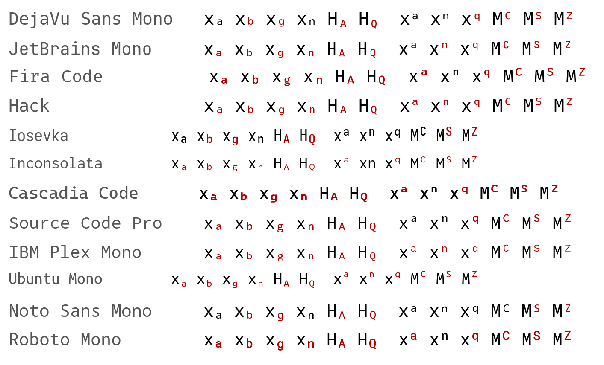

# Script letter fonts

Unicode has no subscript b, c, d, f, g, q, w, y, or z, no uppercase subscripts at all, and no superscript S, X, Y, or Z. Most programming fonts also lack many of the sub- and superscript letters Unicode does have. This repo has companion fonts that fill both gaps for popular monospace fonts, drawn from each font's own letters so they match it.



`specimens/` has a sheet per font showing every sub- and superscript letter.

## Code points

Letters Unicode encodes keep their real code points, such as ₐ (U+2090) and ᵃ (U+1D43). The others go in the Supplementary Private Use Area-B, which Nerd Fonts icons do not use:

- Subscripts: U+100000 plus the ASCII code of the letter, so subscript b is U+100062 and subscript A is U+100041.
- Superscripts: U+100100 plus the ASCII code, so superscript S is U+100153.

Private-use characters show as boxes anywhere without a companion font, so text that uses them only looks right on machines set up for it.

## Fonts

| Companion                | For                   | License                                                          |
| ------------------------ | --------------------- | ---------------------------------------------------------------- |
| DejaVu Sans Mono Scripts | DejaVu Sans Mono 2.37 | Bitstream Vera license, with DejaVu changes in the public domain |
| JetBrains Mono Scripts   | JetBrains Mono 2.305  | OFL 1.1                                                          |
| Fira Code Scripts        | Fira Code 6.2         | OFL 1.1                                                          |
| Hack Scripts             | Hack 3.003            | MIT and the Bitstream Vera license                               |
| Iosevka Scripts          | Iosevka 34.8.0        | OFL 1.1                                                          |
| Inconsolata Scripts      | Inconsolata 3.100     | OFL 1.1                                                          |
| CaskaydiaCove Scripts    | Cascadia Code 2407.24 | OFL 1.1                                                          |
| SauceCodePro Scripts     | Source Code Pro 2.042 | OFL 1.1                                                          |
| BlexMono Scripts         | IBM Plex Mono 2.005   | OFL 1.1                                                          |
| Teranga Mono Scripts     | Ubuntu Mono 0.80      | Ubuntu Font Licence 1.0                                          |
| Noto Sans Mono Scripts   | Noto Sans Mono 2.014  | OFL 1.1                                                          |
| Roboto Mono Scripts      | Roboto Mono 3.001     | OFL 1.1                                                          |

Cascadia Code, Source Code Pro, and IBM Plex Mono have Reserved Font Names, so modified versions cannot use their names. Their companions use the names [Nerd Fonts](https://github.com/ryanoasis/nerd-fonts) chose for the same reason. The Ubuntu Font Licence requires a version as changed as a companion to avoid the Ubuntu name entirely, so the Ubuntu Mono companion is called Teranga Mono Scripts.

Each folder in `fonts/` holds the companion, the license of the font it was made from (which also covers the companion), and config snippets for kitty, Ghostty, and fontconfig. Each companion holds only the letters its font lacks, between 39 and 104 of them.

## Install

Install the companion like any font. On Linux, copy it into `~/.local/share/fonts/` and refresh the font cache:

```
cp fonts/FiraCodeScripts/FiraCodeScripts-Regular.ttf ~/.local/share/fonts/
fc-cache -f
```

On macOS, copy it into `~/Library/Fonts/`. On Windows, open it and click Install.

The letters Unicode lacks then work in most terminals with no further setup: no other font draws their code points, so the system's font fallback finds the companion. The letters Unicode has but your font lacks need the terminal to prefer the companion, or the fallback may draw them from an unrelated font. Each folder in `fonts/` has a snippet for the terminals that read one:

- kitty: add `include /path/to/fonts/FiraCodeScripts/kitty.conf` to `kitty.conf` and restart kitty.
- Ghostty: add `config-file = /path/to/fonts/FiraCodeScripts/ghostty.conf` to the Ghostty config. It applies to new windows.
- WezTerm: list the companion after your font, as in `config.font = wezterm.font_with_fallback { 'Fira Code', 'Fira Code Scripts' }`.
- foot: list the companion after your font in `foot.ini`, as in `font=Fira Code:size=11,Fira Code Scripts:size=11`.
- Windows Terminal 1.21 or later: set the profile's font face to `Fira Code, Fira Code Scripts`.
- Alacritty and other Linux programs that follow fontconfig's fallback order: copy `fontconfig.conf` to `~/.config/fontconfig/conf.d/60-fira-code-scripts.conf` and run `fc-cache -f`. It makes the companion the first fallback for your font, which `fc-match -s 'Fira Code'` shows.

kitty and Ghostty map exact code points to the companion, so they also replace placeholders in your font, like Inconsolata's full-size ⁿ. The others only use the companion for characters your font lacks.

The kitty setup and the fontconfig ordering have been tested. The other entries follow each terminal's documentation.

## Typing them

The private-use letters cannot be typed directly. Bind them in your editor, generating the characters from the scheme above. In Neovim, for example:

```lua
for c in ('bcdfgqwyzABCDEFGHIJKLMNOPQRSTUVWXYZ'):gmatch('.') do
  vim.keymap.set('i', '_' .. c, vim.fn.nr2char(0x100000 + c:byte()))
end
```

Neovim treats these characters as one column wide as long as `ambiwidth` is `single`, the default.

## How they are made

`build.py` reads each source font named in `sources.json`, downloading it and checking its sha256. For every script letter the font lacks, it shrinks the font's own letter the way the font draws the script letters it already has:

- The scale and vertical position come from a pair like a and ᵃ, or n and ⁿ. A font with no script letters gets 63% width, 56% height, and superscript capitals reaching the cap height, which are DejaVu Sans Mono's proportions.
- Many fonts draw their script letters with heavier strokes than plain scaling gives. The build measures this from a pair like n and ⁿ and thickens the strokes with FontForge to match.
- Each glyph is centered in the font's cell, so it stays one column wide. For a proportional font (with `--font`), each glyph instead gets its letter's advance width scaled like the letter, and is centered in that.
- Scripts follow the font's own sub- and superscripts when it has them. Otherwise they go past the baseline or the cap height by the subscript offset the font records (`ySubscriptYOffset`, 0.075 to 0.14 em in these fonts): subscripts drop below the baseline, and superscript capitals rise above the cap height. Capitals go past the line even in fonts whose own lowercase scripts sit on it, like DejaVu Sans Mono's subscripts, because capitals flush with the line are so tall that they read as small capitals. The exception is a font with its own capital superscripts, like ᴬ in DejaVu Sans Mono: the missing ones match those. `--placement` changes this (see below).
- A few fonts fill a script code point with a full-size copy of the letter, like Inconsolata's ⁿ. The build treats those as missing, so terminals that map code points to fonts draw the companion's letter instead.

Building needs Python with fontTools and FontForge's Python module (`python-fonttools` and `fontforge` on Arch). `preview.py` also needs Pillow.

```
./build.py                         # every font in sources.json
./build.py 'Fira Code Scripts'     # one of them
./build.py --font MyFont.ttf 'My Font Scripts'   # any other font file
```

`./preview.py` renders `preview.png` and `specimens/` after a build, and `./preview.py --font MyFont.ttf MyFontScripts-Regular.ttf` renders a specimen for any font and its companion.

`--placement` sets where scripts go when the font has none of its own to copy:

- `capitals-outside` (the default): move every subscript below the baseline and every superscript up so capitals pass the cap height, by the font's subscript offset, and do the same for capitals in fonts whose own lowercase scripts sit on the line.
- `outside`: the same, except that capitals follow the font's own lowercase scripts like lowercase does.
- `flush`: put subscripts on the baseline and superscript capitals at the cap height, unless the font's own scripts go past those lines.

FontForge prints "Internal Error (overlap)" messages for a few Cascadia Code glyphs. The resulting outlines are correct.

## License

The code in this repo is under the MIT license (see `LICENSE`). Each font is under the license in its folder.
